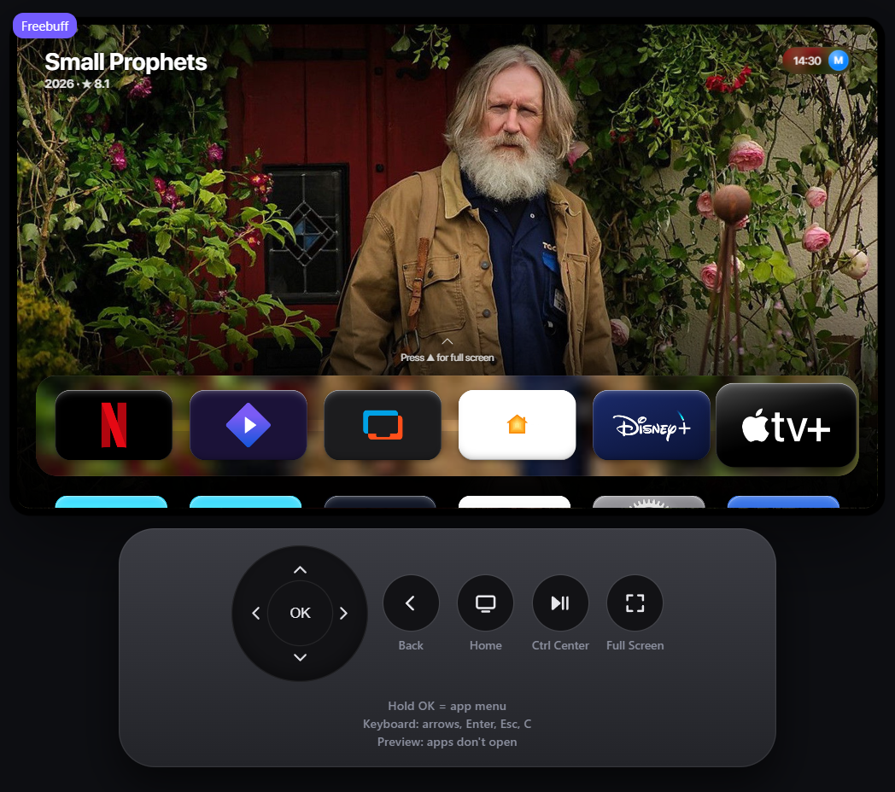
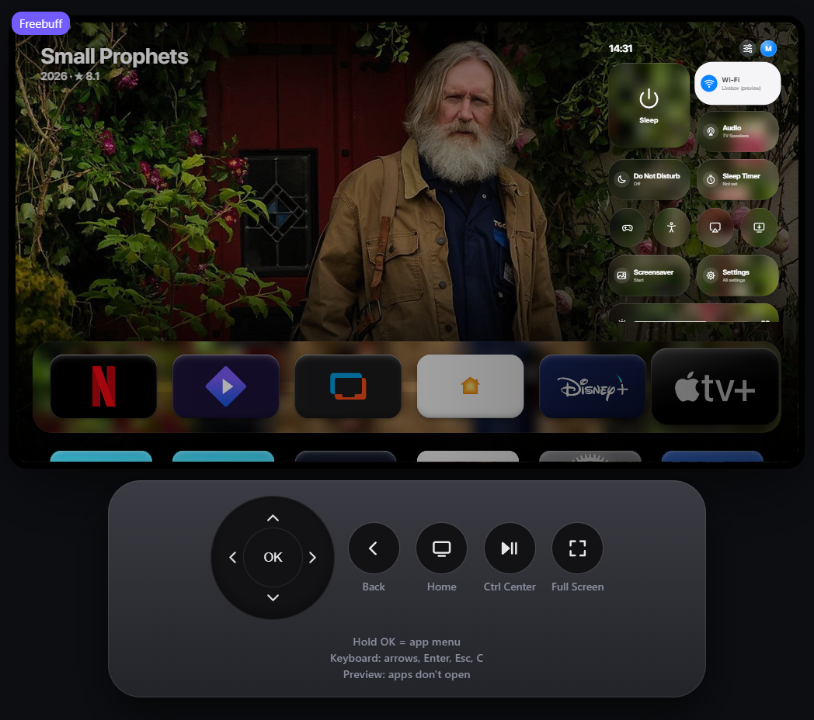
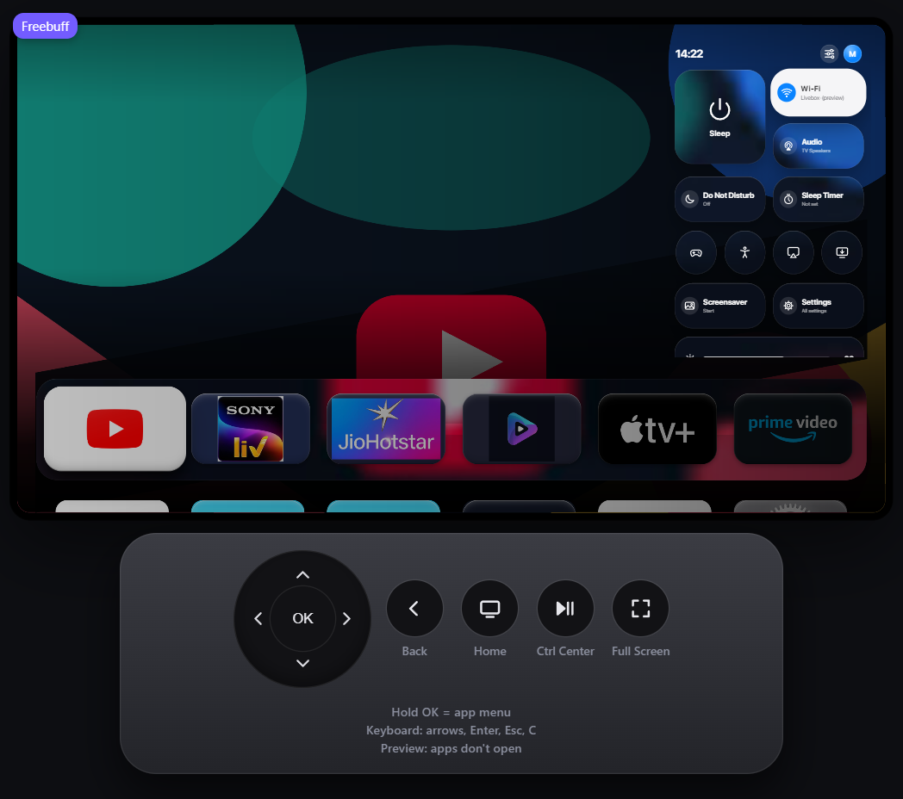
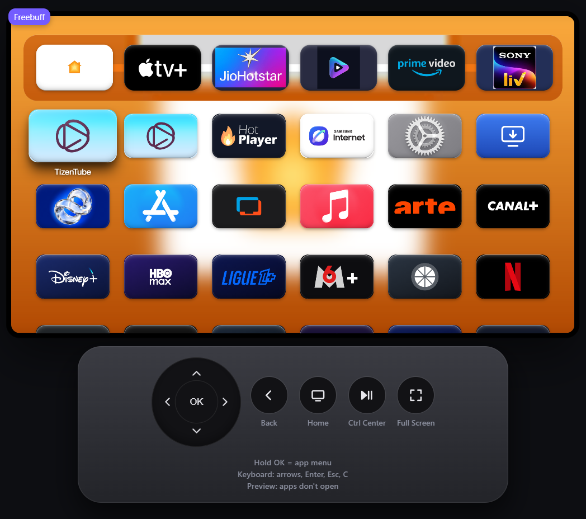
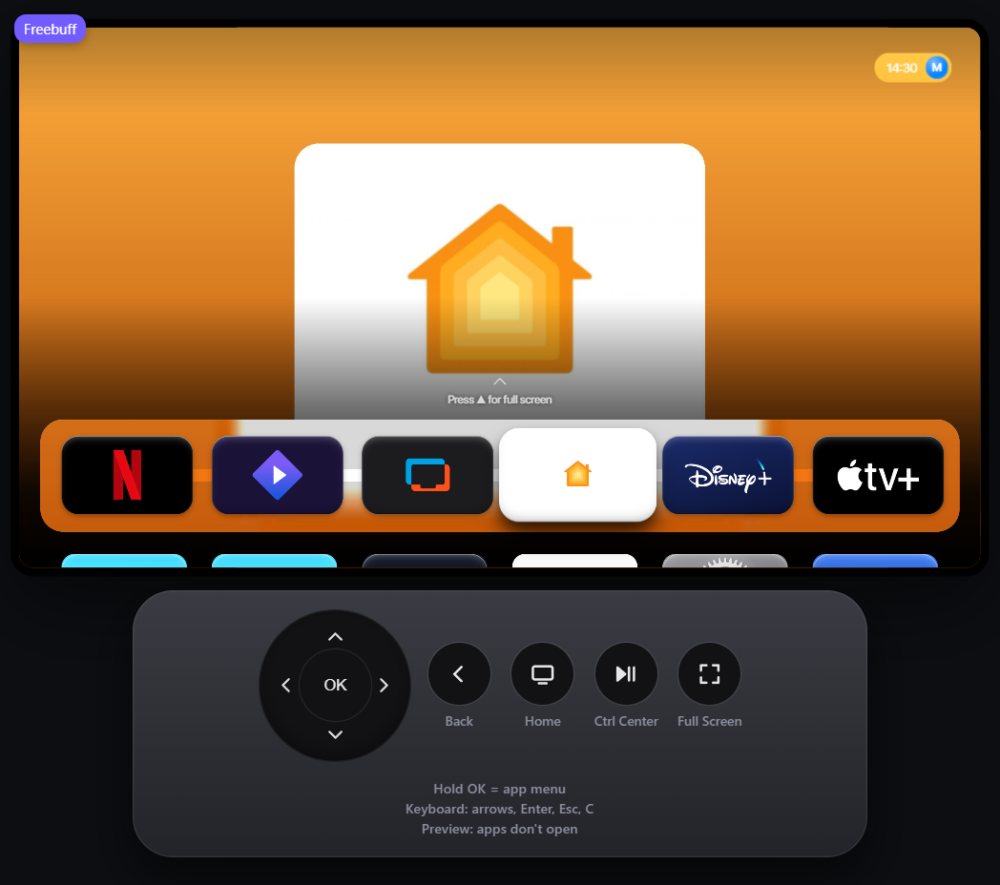
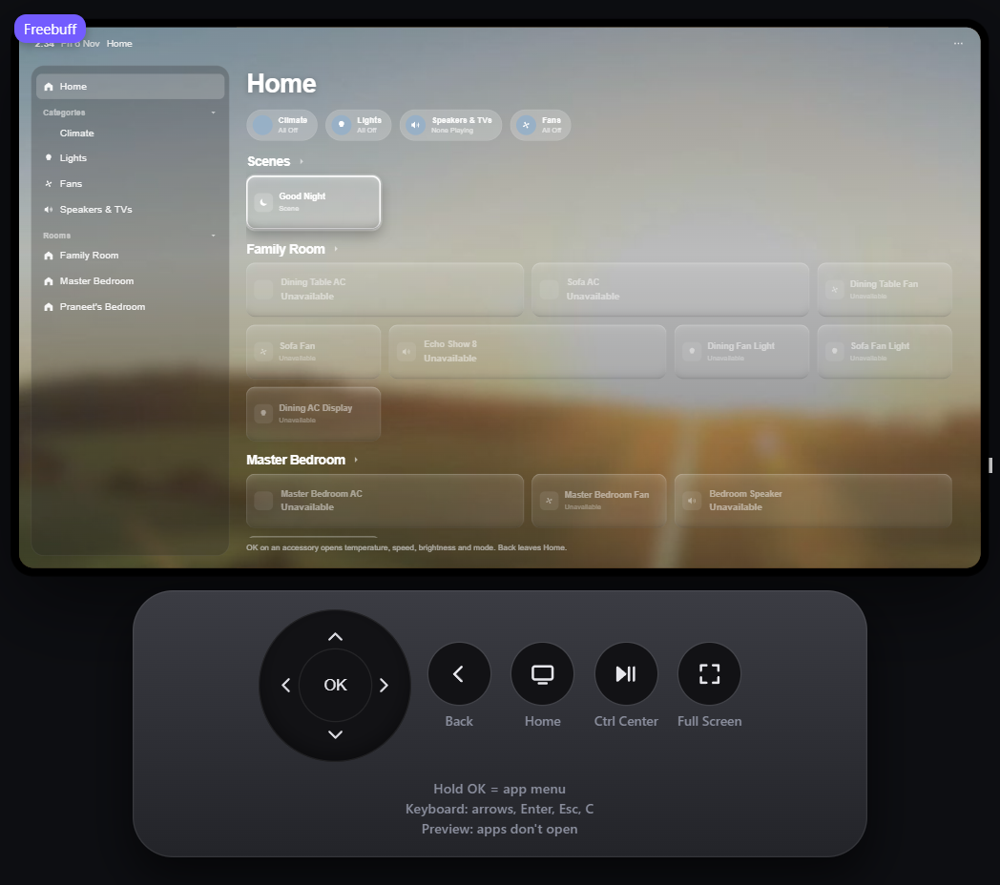
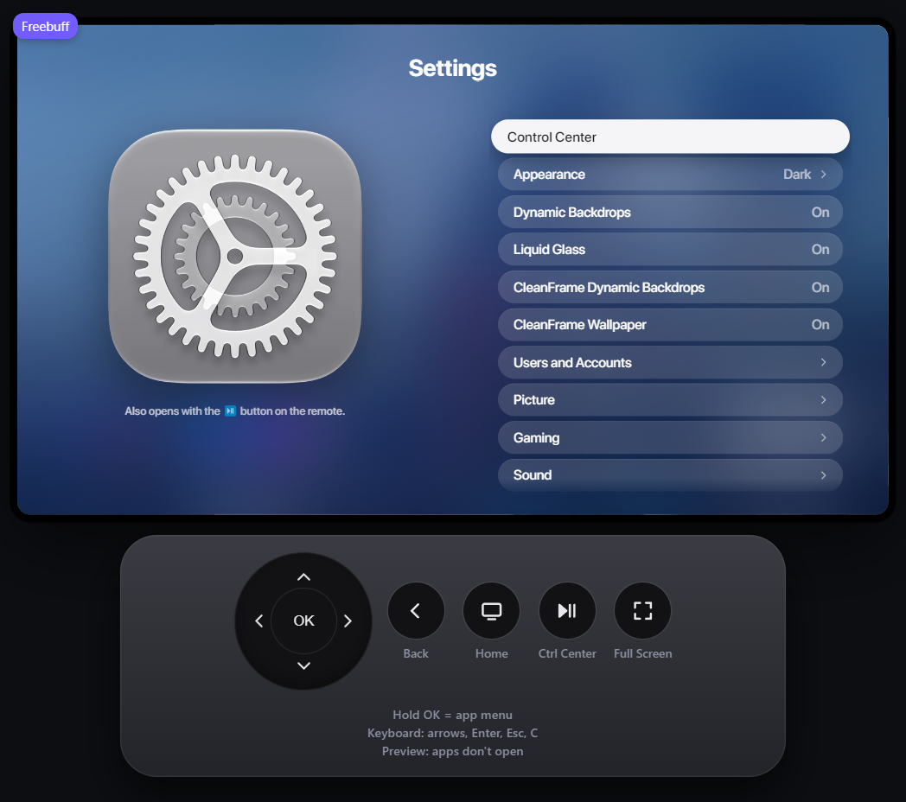

# CleanFrame for the APL Launcher: liquid glass, dynamic backdrops and the Home app

A presentation layer for the launcher on the TV: one pre-blurred backdrop sliced per
surface, posters that follow the app in focus, a rebuilt Control Centre and CleanFrame's
Home Assistant app as a real Home tile. No live blur runs on the animation path.



## What this changes

**The dock** now holds six apps in the requested order — Netflix, Stremio, Samsung TV
Plus, Home, Disney+, Apple TV. Tiles can be rearranged (hold OK → Edit Home Screen, or
Move Left / Move Right) and the arrangement is saved per profile.

**Liquid glass** is a single pre-blurred photograph of the current backdrop, baked once
into a canvas and sliced per surface with `background-position`. The dock, the status
pill, every Control Centre tile and the shelf cards take their own slice, so the glass
lines up across the screen without a backdrop-filter on the GPU path. The glass is dimmed
to 15%: the sheen marks the edge, it no longer lifts the picture.



**Dynamic backdrops** put a title from the service in focus behind the Home Screen. The
poster, the corner slate and the ten-second idle slide all read the same index, so the
name on screen always belongs to the picture on screen. Only titles the service actually
carries are eligible — offers are checked against the service's package and rent/buy
listings are ignored, which is what used to let a rival's show appear behind SonyLIV.

**Control Centre** is a two-column grid at 70%: Sleep (square, 2×2), Wi-Fi and Audio
beside it, Do Not Disturb and Sleep Timer below, a row of four round buttons, Screensaver
and Settings as wide tiles, the brightness slider, and nothing else — the Search button
is gone. Spacing between controls is 18 px.



**The app drawer** blurs the artwork on screen once into a 960×540 canvas and stretches
it: blur only, no saturation, no brightness, no magnification, nothing recomputed while
the grid moves.



**The Home app** is CleanFrame's Home Assistant client as a virtual Home tile with the
HomeKit mark and a pinned photograph behind it.



Opened, it is CleanFrame's Home Assistant client full-screen: rooms down the left, scenes and
accessories on the right, its own keys while it is up. In the browser preview every accessory
reads *Unavailable* because the preview origin is not allowed by the Home Assistant server —
the CORS step in the setup below is what fixes that on the TV.



**Settings** gains the switch between the two backdrops: *CleanFrame Dynamic Backdrops*
on gives the developer's posters and the idle slide, off returns to the artwork each app
already has.



## How it works

### One backdrop, many surfaces

`launcher.js` paints the focused app's artwork into a layer (`.bg`), crossfading opacity
between two layers. `glass.js` reads that layer, draws it once into an offscreen canvas
with `ctx.filter = "blur(…) saturate(…)"`, then gives every surface in `TARGETS`
(`.dock`, `.status`, `.cc__t`, `.scard__art--glass`) its own `background-position` and
`background-size` so the slice matches the surface's box. A new pane is inserted at
opacity 0 and faded in over 320 ms, so the glass melts into a new picture instead of
swapping in one frame.

Remote images are fetched with `img.crossOrigin = "anonymous"`; without it the canvas is
tainted and every lens silently dies.

### Where a backdrop comes from

```
YouTube family        → CleanFrame's own YouTube artwork
CleanFrame catalogue  → bundled app backdrop (cleanFrameBackdrops)
poster catalogue      → JustWatch trending title for that service
app.bg                → the artwork the viewer already had
wallpaper             → cleanFrameWallpaper
brand glow            → flat colour card
```

`wantsPoster(app)` admits the six dock apps and any service the catalogue knows by name
(Netflix, Prime Video, Disney+, HBO Max, Samsung TV Plus, ARTE, SonyLIV, JioHotstar,
Apple TV, Stremio). YouTube is excluded on purpose: it keeps the app's own approach.

`app-art.js` builds a small cache (six-hour lifetime, `localStorage`) from JustWatch:
trending titles with their backdrops, plus one list per service. Services missing from
the worldwide trending page are queried by package in their own storefront — SonyLIV and
JioHotstar in India, ARTE in France, Samsung TV Plus in the US — and every returned title
is re-checked against that service's offers, because JustWatch answers an unsupported
package filter with the whole trending page.

### Rotation

After ten seconds idle the layer slides to the next title in the same service's list and
the glass is re-baked. The slide classes are cleared when the transition ends, so moving
focus later crossfades rather than sliding again. Rotation pauses while a pane or the
drawer is open.

### Dock and drawer

The top row is the six apps of `DOCK`; once a layout has been saved, the first six of
that order are the dock, with Home pinned in, so an app dragged up from the drawer stays
there. The drawer's ground is a pre-rendered blur, built at boot and repainted only when
the artwork changes.

## Home Assistant setup

The Home tile opens CleanFrame's own Home Assistant app (`apl.homeassistant`). To point
it at a house:

1. In Home Assistant, create a long-lived access token (Profile → Security → Long-lived
   access tokens).
2. Give the TV its own dashboard view with big tiles — the kiosk view opened by the app
   is `/dashboard-kiosk/0`.
3. Enter the address and token in the Home app's setup: base URL
   `http://homeassistant.local:8123` (or the LAN address of the server), token pasted,
   dashboard left at the default unless a different view is wanted.
4. Allow the TV's origin in Home Assistant's `http:` → `cors_allowed_origins`, otherwise
   the app's requests are refused.
5. If the Home app is not installed, the tile falls back to opening the dashboard URL in
   the browser, and says so when neither is configured.

Nothing about the house is stored in the repository: the address, the token and the
dashboard path live in the app's own preferences on the TV.

## Testing

- `python scripts/check.py` — widget identity, version and bundled resources: **passes**.
- Browser preview (`python scripts/preview.py --port 4795`, then `/home/`), checked by
  measurement rather than by eye where possible: Control Centre grid gap 18 px, round
  controls 95×96 px in a 100 px row, dock tiles 262 px (224 px when seven), drawer canvas
  960×540 at opacity 1, catalogue cache verified per service.
- `npm run check` / `npm run check:browser` were **not** run here: Node is not installed
  on the machine this was prepared on.

## Limitations

- ARTE and Samsung TV Plus return no package-filtered list from JustWatch (the filter is
  ignored and the trending page comes back), so the offer check drops every candidate and
  those two keep their own artwork instead of another service's show.
- The long-press gesture (hold OK for the app menu) cannot be synthesised in the browser
  preview, so the Move menu is code-verified but not gesture-tested; it needs a press on
  a real remote.
- The screenshots are from the browser preview at 42% scale; the TV renders the same
  layout at 1920×1080.
