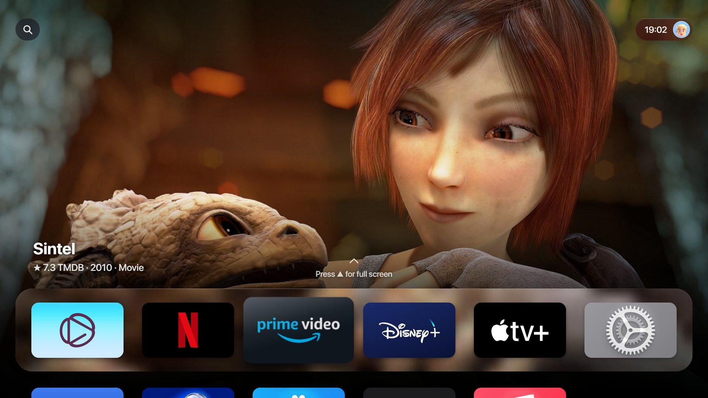
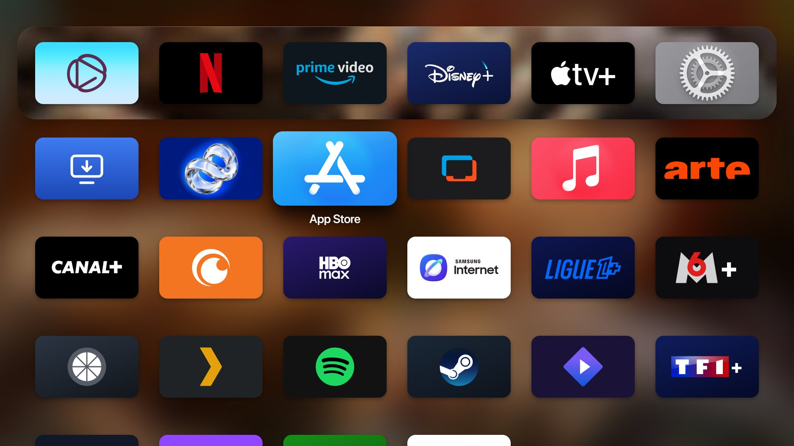
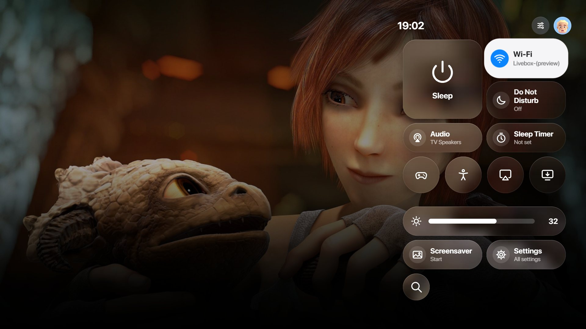
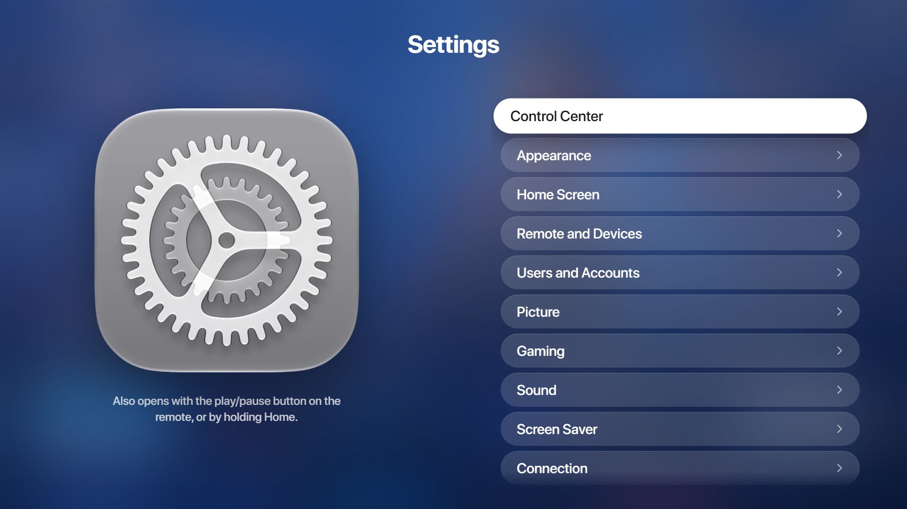
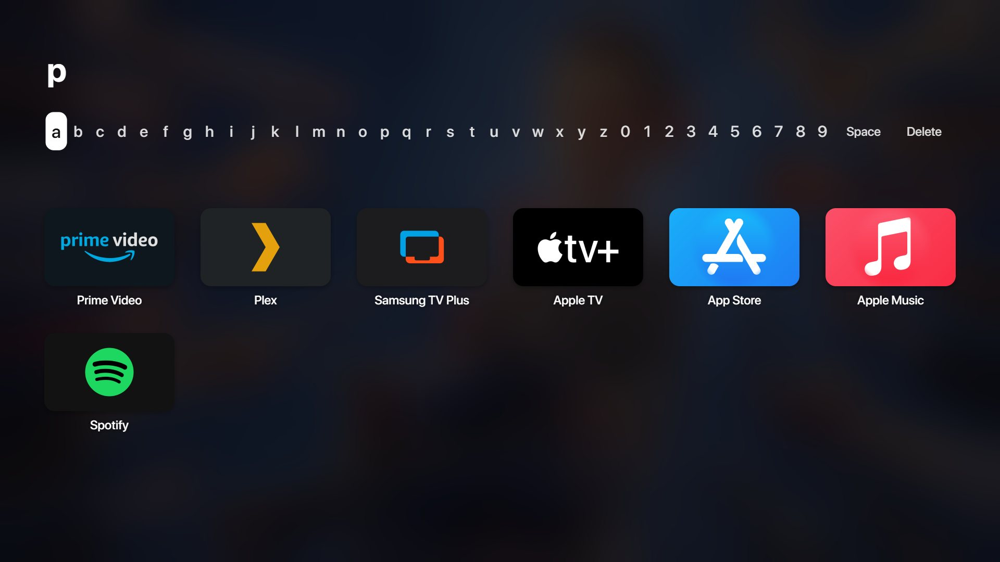
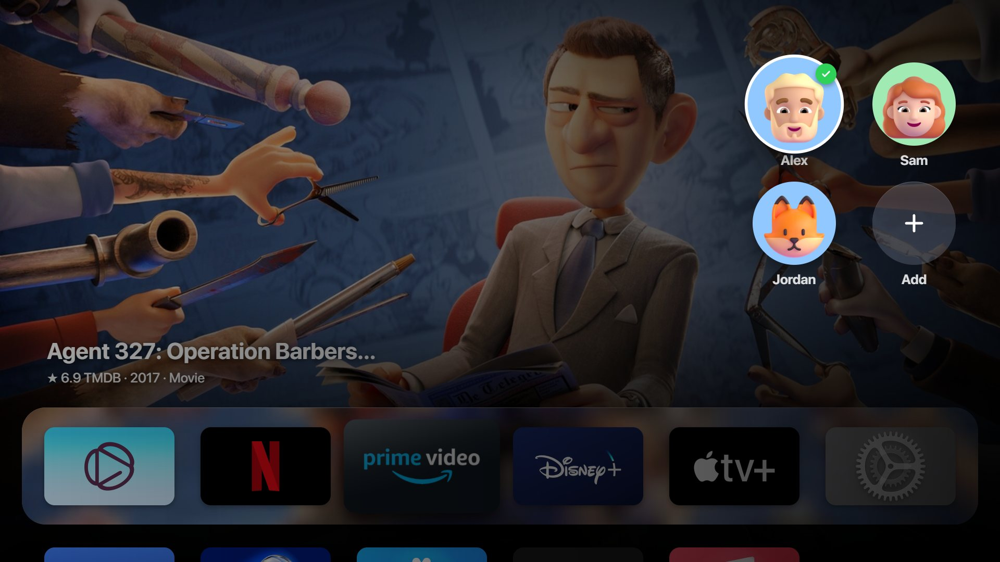
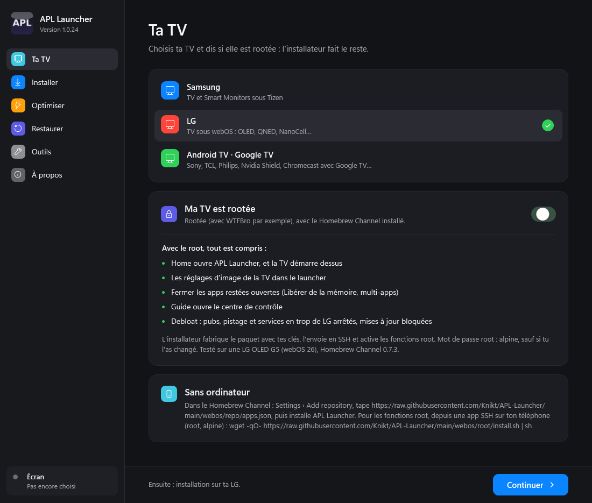
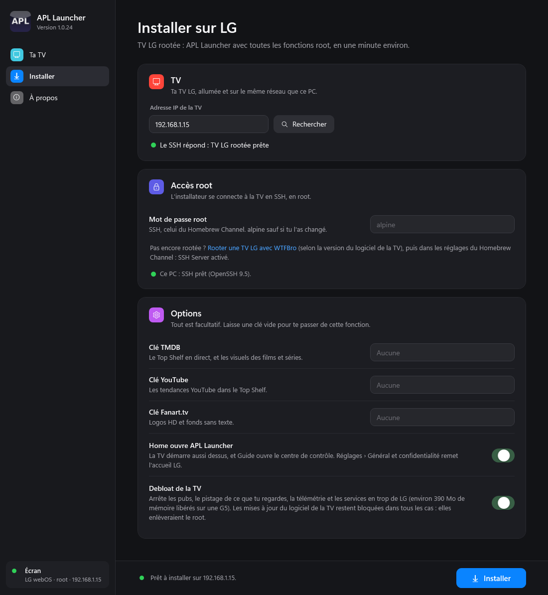

<div align="center">

# APL Launcher

**Un écran d'accueil façon Apple TV pour ta TV.**
Samsung (Tizen) · LG (webOS) · Android TV et Google TV

Créé par Knikt (Gero Corp.)



**[▶ L'essayer dans le navigateur](https://knikt.github.io/APL-Launcher/)** : rien à installer, rien ne touche à ta TV.

[Installer](#installer) · [Quelle TV ?](#quelle-tv-) · [Debloat](#debloat-intégré) · [Nouveautés](CHANGELOG.md) · [Aide](#aide) · [English](README.md)

</div>

---

## Ce que tu as

- **L'accueil de l'Apple TV** : un Top Shelf plein écran pour l'app sur laquelle tu es, un dock en Liquid Glass, une grille d'apps, des dossiers, des animations fluides et des sons.
- **« Continuer de regarder »** depuis tes apps (lecteurs IPTV, Stremio, [APL TV](https://github.com/Knikt/APL-TV)), et les tendances de Netflix, Prime Video, Disney+, YouTube et d'autres.
- **Centre de contrôle**, **Recherche**, **Réglages** (avec les vrais réglages d'image de ta TV), **Sources** pour les entrées HDMI, des **profils** pour la famille, un **économiseur d'écran** avec les vues aériennes.
- **Home ouvre APL Launcher**, deux fois Home pour le multi-apps, et la TV démarre dessus en une seconde environ.
- **Un debloat intégré** : pubs, pistage et apps ou services inutiles enlevés. [Plus bas](#debloat-intégré).
- **Se met à jour tout seul**, en **français et en anglais**.

| | | |
|---|---|---|
|  |  |  |
|  |  |  |

## Quelle TV ?

| TV | Sans root | Avec root |
|---|---|---|
| **Samsung** (Tizen 7 et plus ; Tizen 6 en partie) | Le launcher comme une app, installé avec [Apps2Samsung](https://github.com/Apps2Samsung/Apps2Samsung) | **Tout**, avec [Vetro](https://github.com/andrearicci93/vetro) sur l'écran |
| **LG** (webOS) | Le launcher, par le mode développeur de LG (il faut un PC) | **Tout**, avec le Homebrew Channel ([rootée](https://e.nya.je/getroot/)) |
| **Android TV, Google TV** | **Tout** : pas besoin de root | — |

Ce que le root ajoute : Home ouvre APL Launcher et la TV démarre dessus, le centre de contrôle par-dessus les apps (Samsung) ou sur la touche Guide (LG), la fermeture des apps restées ouvertes, les réglages d'image de la TV dans le launcher, et le debloat. L'installateur te le montre pour ta TV. Ce qui marche sur quel modèle : [docs/compatibility.md](docs/compatibility.md).

## Installer

Prends la ligne de ta TV. **APL Launcher Setup** (Windows) fait tout pour toi ; les autres façons se passent de PC, ou servent à le faire à la main.

| Ta TV | Avec un PC Windows | Sans ordinateur |
|---|---|---|
| **Samsung rootée** (Vetro) | [APL Launcher Setup](#apl-launcher-setup-windows) : tout | [Apps2Samsung](#apps2samsung-samsung) depuis un téléphone, puis *Régler les touches de la télécommande* dans le launcher |
| **Samsung non rootée** | — | [Apps2Samsung](#apps2samsung-samsung) : le launcher comme une app |
| **LG rootée** (Homebrew Channel) | [APL Launcher Setup](#apl-launcher-setup-windows) : tout, en une minute environ | [Dépôt du Homebrew Channel](#homebrew-channel-lg-rootée), puis [une commande SSH](#fonctions-root-sur-lg-à-la-main) pour les fonctions root |
| **LG non rootée** | [APL Launcher Setup](#apl-launcher-setup-windows) par le mode développeur de LG | — (sans root, LG ne laisse installer des apps que depuis un PC) |
| **Android TV, Google TV** | [APL Launcher Setup](#apl-launcher-setup-windows) avec adb | L'app [Downloader](#downloader-android-tv) sur la TV, code **9890834** |

Tous les fichiers sont dans la [dernière version](https://github.com/Knikt/APL-Launcher/releases/latest).

### APL Launcher Setup (Windows)

Pour toutes les TV, rootées ou non. Windows 10 ou 11, sur le même réseau que la TV.

1. **Télécharge APL Launcher Setup** (`APL-Launcher-Setup.exe`) depuis la [dernière version](https://github.com/Knikt/APL-Launcher/releases/latest) et ouvre-le. Si Windows dit que l'app n'est pas signée : *Informations complémentaires › Exécuter quand même*.
2. **Choisis ta TV** et dis si elle est rootée. L'installateur montre ce que tu auras, et ce qui manque sans root.

   

3. **Tape l'adresse IP de la TV** (ou clique sur **Rechercher**) et clique sur **Installer**. Ajoute tes clés gratuites TMDB, YouTube et Fanart.tv si tu en as : elles apportent le Top Shelf en direct et les visuels.

   

Ce qu'il fait sur chaque TV :
- **Samsung (rootée)** : fabrique APL Launcher avec tes clés, le signe avec ton certificat Samsung et l'installe par Vetro. Il faut Tizen Studio et le certificat sur le PC : l'installateur les vérifie et te dit quoi faire. Ses pages **Optimiser** et **Restaurer** sont aussi pour Samsung.
- **LG rootée** : fabrique le paquet avec tes clés et l'envoie en SSH (utilisateur `root`, mot de passe `alpine` sauf si tu l'as changé), l'installe, puis active les fonctions root et le debloat. Testé sur une LG OLED G5 (webOS 26) avec le Homebrew Channel 0.7.3.
- **LG non rootée** : installe par l'app **Developer Mode** de LG (un compte développeur LG gratuit ; active *Dev Mode Status*, puis *Key Server*, et tape sa phrase secrète dans l'installateur). APL Launcher renouvelle tout seul les 1000 heures du mode développeur.
- **Android TV** : trouve adb (ou télécharge une fois les platform-tools de Google), installe le launcher et APL Launcher Home Button, active le service des boutons du module (Home ouvre APL Launcher) et autorise le launcher à s'afficher par-dessus les apps (son Centre de contrôle sur l'app au premier plan). Active d'abord le *débogage USB* ou le *débogage réseau* dans les *Options pour les développeurs* de la TV (*Paramètres › Préférences de l'appareil › À propos*, appuie sept fois sur OK sur *Build*).

Le guide complet, étape par étape : [docs/installation.md](docs/installation.md) (en anglais).

### Homebrew Channel (LG rootée)

Sans ordinateur. Sur la TV, ouvre le **Homebrew Channel**, puis *Settings* › **Add repository**, tape

`https://raw.githubusercontent.com/Knikt/APL-Launcher/main/webos/repo/apps.json`

reviens à la liste, ouvre **APL Launcher** et choisis **Install**. Les nouvelles versions s'y affichent aussi.

### Fonctions root sur LG, à la main

Installé depuis le Homebrew Channel, APL Launcher marche comme sur une TV sans root. Pour les fonctions root (Home ouvre APL Launcher, réglages d'image de la TV, fermeture des apps, Guide = centre de contrôle, debloat, mises à jour bloquées), lance une fois en SSH, depuis un PC ou une app SSH sur ton téléphone (utilisateur `root`, mot de passe `alpine`) :

```sh
wget -qO- https://raw.githubusercontent.com/Knikt/APL-Launcher/main/webos/root/install.sh | sh
```

Pour tout annuler : `sh /media/developer/apl-debloat/uninstall.sh`. Détails : [webos/root/README.md](webos/root/README.md).

### Downloader (Android TV)

Sans ordinateur. Installe l'app **Downloader** (d'AFTVnews) sur la TV, ouvre-la et tape le code **9890834** (ou le lien complet `https://github.com/Knikt/APL-Launcher/releases/latest/download/apl-launcher-android.apk`).

C'est toujours la dernière version. Installe-la, puis ouvre APL Launcher : il demande ce qu'il faut pour Home.

Pour le bouton Home (Home, l'appui long sur Home et ⏯ par-dessus les apps), ajoute **APL Launcher Home Button**, une petite seconde app : `https://github.com/Knikt/APL-Launcher/releases/latest/download/apl-launcher-home-button.apk`. Elle est à part car Google Play Protect bloque toute app installée hors du Play Store qui utilise l'accessibilité : désactive *Analyser les applications avec Play Protect* (Play Store › profil › Paramètres › Play Protect) le temps de l'installer, puis réactive-le. Le launcher l'explique dans *Réglages › Android TV* ([docs/android.md](docs/android.md)).

### adb, à la main (Android TV)

```sh
adb connect <ip-de-la-tv>
adb install -r apl-launcher-v1.2.0-android.apk
adb install -r apl-launcher-home-button-v1.2.0-android.apk
```

Puis ouvre APL Launcher une fois. Plus de détails, dont la touche Home : [docs/android.md](docs/android.md).

### Apps2Samsung (Samsung)

Depuis un téléphone ou un PC, [Apps2Samsung](https://github.com/Apps2Samsung/Apps2Samsung) signe et installe `apl-launcher-full-vX.Y.Z.wgt` (Tizen 7 et plus) pour ton écran ; sur Tizen 6, la paire `tizen60` ou `tizen65`. Avec Vetro, ouvre ensuite *Réglages › Télécommande et appareils › Régler les touches de la télécommande* dans le launcher. Sur macOS ou Linux, `scripts/install-via-vetro.py` installe aussi par Vetro ([guide](docs/installation.md)).

## Debloat intégré

| TV | Ce qui est enlevé | Annuler |
|---|---|---|
| **Samsung** (avec Vetro) | La page **Optimiser** de l'installateur : apps inutilisées, pubs de Samsung, pistage de ce que tu regardes et Bixby, domaines de pub bloqués. Elle montre toute la liste et attend ton accord. [Détails](docs/optimizer.md) | Page **Restaurer** |
| **LG** (rootée) | Les pubs de LG, le pistage LivePlus, la télémétrie, les suggestions et une douzaine de services inutiles (environ 390 Mo de mémoire libérés sur une OLED G5). Les mises à jour du logiciel de la TV sont bloquées, pour qu'elles n'enlèvent pas le root. AirPlay, Chromecast, ThinQ et les apps de streaming marchent toujours. [Détails](webos/root/README.md) | Une commande, ou l'interrupteur de l'installateur |
| **Android TV** | Rien n'est enlevé : le launcher de la TV reste simplement derrière APL Launcher. | — |

Rien n'est supprimé du système de la TV : tout est seulement coupé, et revient.

## Mises à jour

- **Samsung** : APL Launcher se met à jour tout seul depuis ce dépôt, et revient à la version installée si une nouvelle ne démarre pas.
- **LG** : le Homebrew Channel montre les nouvelles versions (si tu l'as installé depuis son dépôt), sinon relance l'installateur.
- **Android TV** : relance l'installateur, ou installe le nouveau `.apk`.

Les nouveautés : [CHANGELOG.md](CHANGELOG.md).

## APL TV

**[APL TV](https://github.com/Knikt/APL-TV)** est le lecteur IPTV qui va avec APL Launcher : TV en direct, guide des programmes, films et séries depuis tes propres playlists M3U, comptes Xtream et serveurs Jellyfin, Emby ou Plex, dans le même style. Sur Samsung, LG et Android TV. Son « Continuer de regarder » s'affiche sur l'accueil d'APL Launcher. Il est livré sans chaîne ni fournisseur : utilise-le avec des contenus que tu as le droit de regarder.

## Aide

- [Installation pas à pas](docs/installation.md) · [Compatibilité](docs/compatibility.md) · [Guide d'utilisation](docs/user-guide.md) · [Dépannage](docs/troubleshooting.md) (en anglais)
- Samsung : [Optimiser](docs/optimizer.md) · LG : [scripts root](webos/root/README.md) · Android : [touche Home et plus](docs/android.md)

**C'est sans risque ?** Rien n'est supprimé du système de la TV. Sur Samsung, **Restaurer** annule tout ; sur LG, `sh /media/developer/apl-debloat/uninstall.sh` ; sur Android, désinstalle l'app.

**Ça lance des apps Android sur Samsung ou LG ?** Non : Tizen et webOS ne peuvent pas les faire tourner, root ou pas.

Les issues et les pull requests sont les bienvenues : [CONTRIBUTING.md](CONTRIBUTING.md). Merci à skjnldsv, exzos28, praneetchoudhary0-droid et BPHvZ pour les leurs.

## Soutenir APL Launcher

APL Launcher est gratuit, libre et fait par une seule personne sur son temps libre. S'il te plaît, tu peux m'offrir un café sur [Ko-fi](https://ko-fi.com/knikt). Jamais obligatoire : tout reste gratuit.

[](https://ko-fi.com/knikt)

## Licence

APL Launcher est créé par Knikt (Gero Corp.). Code sous [licence MIT](LICENSE). APL Launcher est un projet indépendant, sans lien avec Apple, Samsung, LG, Google ou Amazon ; leurs marques et logos appartiennent à leurs propriétaires. Les crédits complets sont dans le [README en anglais](README.md#license-trademarks-and-credits).
