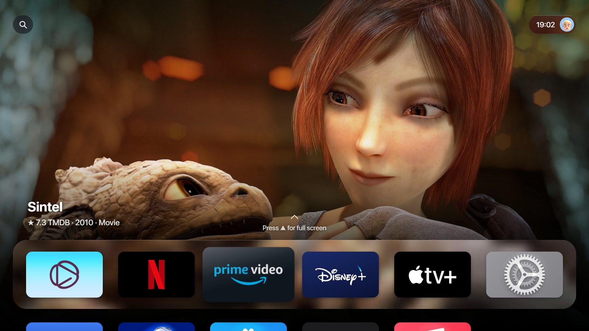
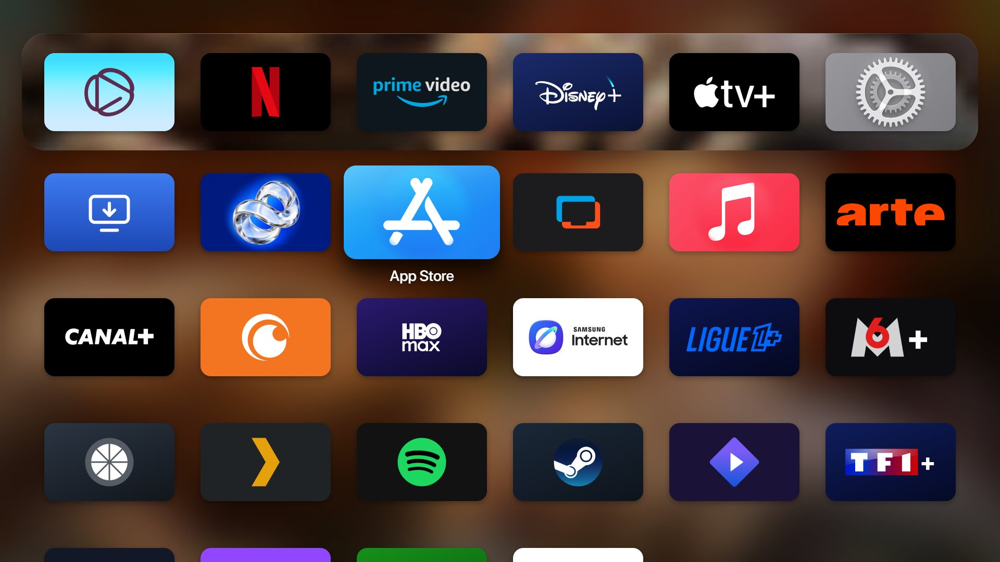
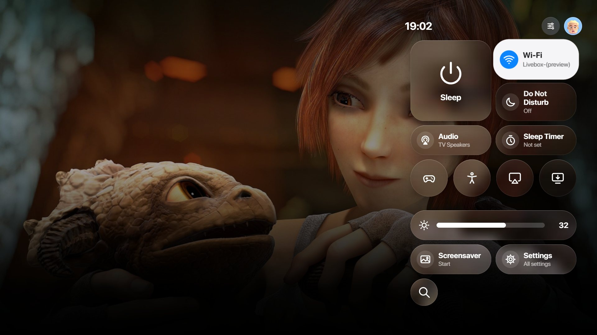
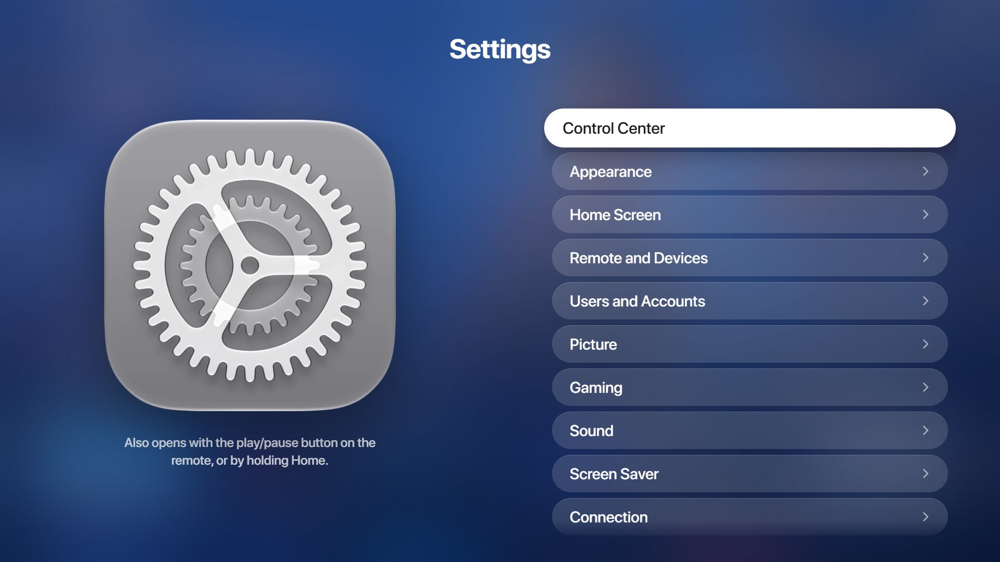
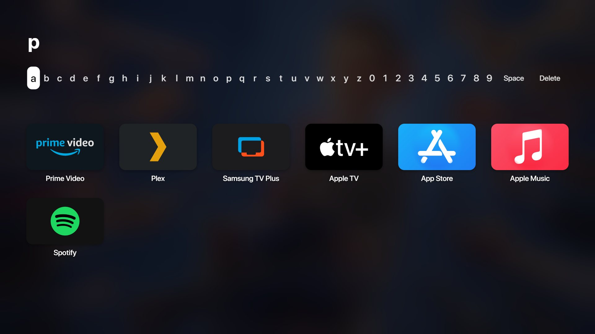
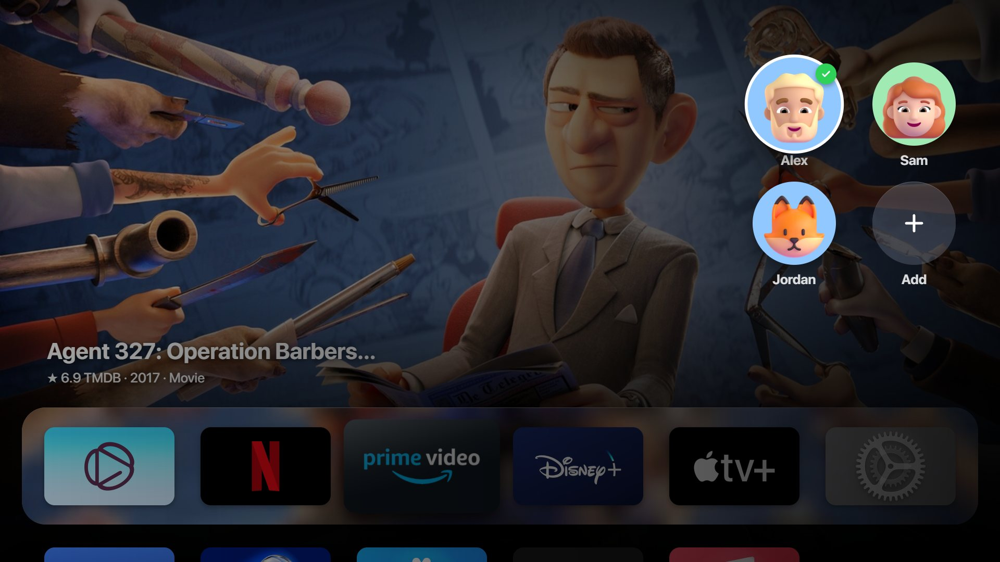
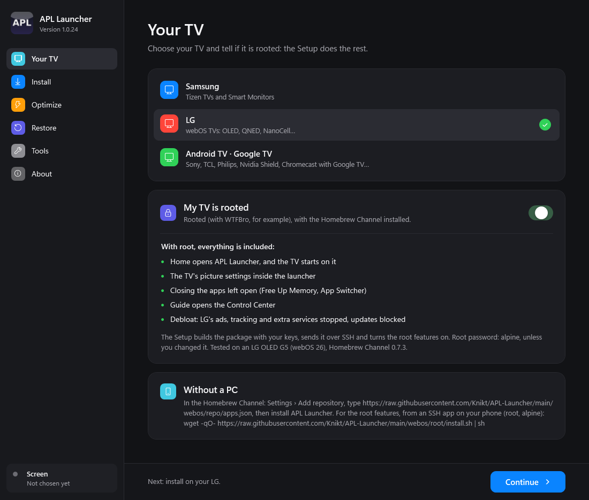
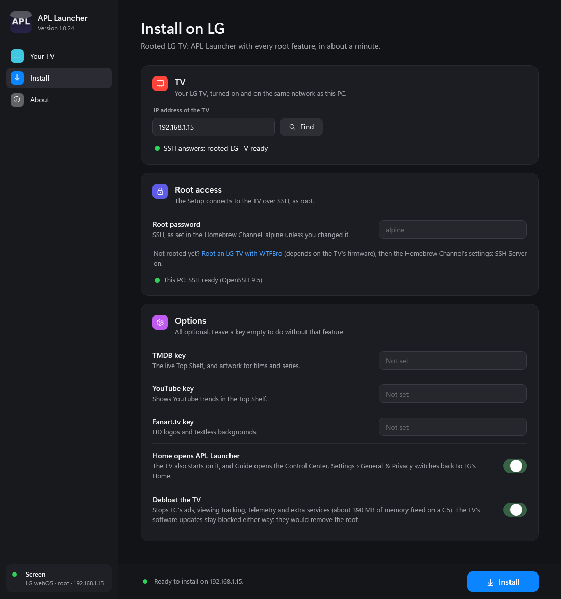

<div align="center">

# APL Launcher

**An Apple TV–style home screen for your TV.**
Samsung (Tizen) · LG (webOS) · Android TV and Google TV

Created by Knikt (Gero Corp.)



**[▶ Try it in your browser](https://knikt.github.io/APL-Launcher/)**: nothing to install, nothing touches your TV.

[Install](#install) · [Which TV?](#which-tv) · [Debloat](#debloat-built-in) · [What's new](CHANGELOG.md) · [Help](#help) · [Français](README.fr.md)

</div>

---

## What you get

- **The Apple TV home screen**: a full-screen Top Shelf for the app you are on, a Liquid Glass dock, a grid of apps, folders, smooth motion and sounds.
- **Continue Watching** from your apps (IPTV players, Stremio, [APL TV](https://github.com/Knikt/APL-TV)), and what is trending on Netflix, Prime Video, Disney+, YouTube and more.
- **Control Center**, **Search**, **Settings** (your TV's own picture settings included), **Sources** for the HDMI inputs, **profiles** for the household, an **aerial screen saver**.
- **Home opens APL Launcher**, twice Home for the App Switcher, and the TV starts on it in about a second.
- **A built-in debloat**: ads, tracking and useless apps or services removed. [More below](#debloat-built-in).
- **Updates by itself**, in **English and French**.

| | | |
|---|---|---|
|  |  |  |
|  |  |  |

## Which TV?

| TV | Without root | With root |
|---|---|---|
| **Samsung** (Tizen 7 and later; Tizen 6 in part) | The launcher as an app, installed with [Apps2Samsung](https://github.com/Apps2Samsung/Apps2Samsung) | **Everything**, with [Vetro](https://github.com/andrearicci93/vetro) on the screen |
| **LG** (webOS) | The launcher, through LG's Developer Mode (needs a PC) | **Everything**, with the Homebrew Channel ([rooted](https://e.nya.je/getroot/)) |
| **Android TV, Google TV** | **Everything**: no root needed | — |

What root adds: Home opens APL Launcher and the TV starts on it, the Control Center over apps (Samsung) or on the Guide button (LG), closing the apps left open, the TV's picture settings inside the launcher, and the debloat. The Setup lists it for your TV. What works on which model: [docs/compatibility.md](docs/compatibility.md).

## Install

Pick the line for your TV. **APL Launcher Setup** (Windows) does everything for you; the other ways need no PC, or are for doing it by hand.

| Your TV | With a Windows PC | Without a PC |
|---|---|---|
| **Samsung, rooted** (Vetro) | [APL Launcher Setup](#apl-launcher-setup-windows): everything | [Apps2Samsung](#apps2samsung-samsung) from a phone, then *Set Up the Remote Buttons* in the launcher |
| **Samsung, not rooted** | — | [Apps2Samsung](#apps2samsung-samsung): the launcher as an app |
| **LG, rooted** (Homebrew Channel) | [APL Launcher Setup](#apl-launcher-setup-windows): everything, in about a minute | [Homebrew Channel repository](#homebrew-channel-lg-rooted), then [one SSH command](#root-features-on-lg-by-hand) for the root features |
| **LG, not rooted** | [APL Launcher Setup](#apl-launcher-setup-windows) through LG's Developer Mode | — (without root, LG lets only a PC install apps) |
| **Android TV, Google TV** | [APL Launcher Setup](#apl-launcher-setup-windows) with adb | The [Downloader](#downloader-android-tv) app on the TV, code **9890834** |

All the files are on the [latest release](https://github.com/Knikt/APL-Launcher/releases/latest).

### APL Launcher Setup (Windows)

For every TV, rooted or not. Windows 10 or 11, on the same network as the TV.

1. **Download APL Launcher Setup** (`APL-Launcher-Setup.exe`) from the [latest release](https://github.com/Knikt/APL-Launcher/releases/latest) and open it. If Windows says the app is not signed: *More info › Run anyway*.
2. **Choose your TV** and tell whether it is rooted. The Setup shows what you get, and what is missing without root.

   

3. **Type the TV's IP address** (or click **Find**) and click **Install**. Add your free TMDB, YouTube and Fanart.tv keys if you have them: they bring the live Top Shelf and the artwork.

   

What it does on each TV:
- **Samsung (rooted)**: builds APL Launcher with your keys, signs it with your Samsung certificate and installs it through Vetro. It needs Tizen Studio and the certificate on the PC: the Setup checks them and says what to do. Its **Optimize** and **Restore** pages are for Samsung too.
- **LG, rooted**: builds the package with your keys and sends it over SSH (user `root`, password `alpine` unless you changed it), installs it, then turns on the root features and the debloat. Tested on an LG OLED G5 (webOS 26) with Homebrew Channel 0.7.3.
- **LG, not rooted**: installs through LG's **Developer Mode** app (a free LG developer account; turn on *Dev Mode Status*, then *Key Server*, and type its passphrase in the Setup). APL Launcher renews the Developer Mode's 1000 hours by itself.
- **Android TV**: finds adb (or downloads Google's platform-tools once), installs the launcher and APL Launcher Home Button, turns on the module's remote buttons service (Home opens APL Launcher) and lets the launcher draw over apps (its Control Center over the app in front). First turn on *USB debugging* or *Network debugging* in the TV's *Developer options* (*Settings › Device Preferences › About*, press OK seven times on *Build*).

The full guide, step by step: [docs/installation.md](docs/installation.md).

### Homebrew Channel (LG, rooted)

No PC needed. On the TV, open the **Homebrew Channel**, then *Settings* › **Add repository**, type

`https://raw.githubusercontent.com/Knikt/APL-Launcher/main/webos/repo/apps.json`

go back to the list, open **APL Launcher** and choose **Install**. New versions show up there too.

### Root features on LG, by hand

Installed from the Homebrew Channel, APL Launcher works like on a TV without root. For the root features (Home opens APL Launcher, the TV's picture settings, closing apps, Guide = Control Center, debloat, updates blocked), run this once over SSH, from a PC or from an SSH app on your phone (user `root`, password `alpine`):

```sh
wget -qO- https://raw.githubusercontent.com/Knikt/APL-Launcher/main/webos/root/install.sh | sh
```

Undo it all: `sh /media/developer/apl-debloat/uninstall.sh`. Details: [webos/root/README.md](webos/root/README.md).

### Downloader (Android TV)

No PC needed. Install the **Downloader** app (by AFTVnews) on the TV, open it and type the code **9890834** (or the full link `https://github.com/Knikt/APL-Launcher/releases/latest/download/apl-launcher-android.apk`).

For the Home button (Home, holding Home and ⏯ over every app), add **APL Launcher Home Button**, a small second app: `https://github.com/Knikt/APL-Launcher/releases/latest/download/apl-launcher-home-button.apk`. It is separate because Google Play Protect blocks any sideloaded app that uses Accessibility: turn off *Scan apps with Play Protect* (Play Store › profile › Settings › Play Protect) while installing it, then turn it back on. The launcher explains it in *Settings › Android TV* ([docs/android.md](docs/android.md)).

It always gives the latest version. Install it, then open APL Launcher: it asks for what Home needs.

### adb, by hand (Android TV)

```sh
adb connect <tv-ip>
adb install -r apl-launcher-v1.2.0-android.apk
adb install -r apl-launcher-home-button-v1.2.0-android.apk
```

Then open APL Launcher once. More, including the Home button: [docs/android.md](docs/android.md).

### Apps2Samsung (Samsung)

From a phone or a PC, [Apps2Samsung](https://github.com/Apps2Samsung/Apps2Samsung) signs and installs `apl-launcher-full-vX.Y.Z.wgt` (Tizen 7 and later) for your screen; on Tizen 6, the `tizen60` or `tizen65` pair. With Vetro, then open *Settings › Remote and Devices › Set Up the Remote Buttons* in the launcher. On macOS or Linux, `scripts/install-via-vetro.py` installs through Vetro too ([guide](docs/installation.md)).

## Debloat built in

| TV | What it removes | Undo |
|---|---|---|
| **Samsung** (with Vetro) | The Setup's **Optimize** page: unused apps, Samsung's ads, viewing tracking and Bixby, ad domains blocked. It shows the full list and waits for your OK. [Details](docs/optimizer.md) | **Restore** page |
| **LG** (rooted) | LG's ads, LivePlus viewing tracking, telemetry, suggestions and a dozen unneeded services (about 390 MB of memory freed on an OLED G5). The TV's software updates are blocked, so they can't remove the root. AirPlay, Chromecast, ThinQ and the streaming apps keep working. [Details](webos/root/README.md) | One command, or the Setup's switch |
| **Android TV** | Nothing is removed: the TV's own launcher just stays behind APL Launcher. | — |

Nothing is deleted from the TV's system: it is all switched off, and comes back.

## Updates

- **Samsung**: APL Launcher updates itself from this repository, and goes back to the installed version if a new one fails to start.
- **LG**: the Homebrew Channel shows the new versions (when installed from its repository), or run the Setup again.
- **Android TV**: run the Setup again, or install the new `.apk`.

What changed: [CHANGELOG.md](CHANGELOG.md).

## APL TV

**[APL TV](https://github.com/Knikt/APL-TV)** is the IPTV player that goes with APL Launcher: Live TV, a TV guide, movies and series from your own M3U playlists, Xtream accounts and Jellyfin, Emby or Plex servers, in the same style. On Samsung, LG and Android TV. Its *Continue Watching* shows on APL Launcher's Home Screen. It comes with no channels and no provider: use it with content you have the right to watch.

## Help

- [Installation, step by step](docs/installation.md) · [Compatibility](docs/compatibility.md) · [User guide](docs/user-guide.md) · [Troubleshooting](docs/troubleshooting.md)
- Samsung: [Optimize](docs/optimizer.md) · LG: [root scripts](webos/root/README.md) · Android: [Home button and more](docs/android.md)
- For developers: [Development](docs/development.md) · [Visuals and APIs](docs/visuals-and-apis.md) · [Setup](installer/README.md)

**Is it safe?** Nothing in the TV's system is deleted. On Samsung, **Restore** undoes everything; on LG, `sh /media/developer/apl-debloat/uninstall.sh`; on Android, uninstall the app.

**Can it play Android apps on Samsung or LG?** No: Tizen and webOS can't run them, root or not.

Issues and pull requests are welcome: [CONTRIBUTING.md](CONTRIBUTING.md). Thanks to skjnldsv, exzos28, praneetchoudhary0-droid and BPHvZ for theirs.

## Support APL Launcher

APL Launcher is free, open source and made by one person in my spare time. If you like it, you can buy me a coffee on [Ko-fi](https://ko-fi.com/knikt). Never required: everything stays free.

[](https://ko-fi.com/knikt)

## License, trademarks and credits

The source code is released under the [MIT License](LICENSE).

APL Launcher is an independent project. It is not affiliated with, endorsed by or sponsored by Apple, Samsung, LG, Google or Amazon. Apple, Apple TV, tvOS, AirPlay, AirPods, Siri and Memoji are trademarks of Apple Inc. Samsung, Tizen and Smart Hub, LG and webOS, Android, Google TV and Chromecast, Amazon and Alexa are trademarks of their owners. App, service and device logos belong to their owners and are shown only to identify them.

APL Launcher is created by Knikt (Gero Corp.).

Vetro by andrearicci93 · TizenBrew and TizenTube by reisxd · the Homebrew Channel by webosbrew · LG debloat based on [CleanYourTV](https://github.com/lasharor/cleanyourtv-WebOS) and [Own Your Glass](https://github.com/JulioFerrero/own-your-glass) (MIT), blocklist from [lg-tv-blocklist](https://github.com/furkan-bayrak/lg-tv-blocklist) (CC BY 4.0) · icons from [dashboard-icons](https://github.com/homarr-labs/dashboard-icons), [Simple Icons](https://simpleicons.org), [selfh.st/icons](https://github.com/selfhst/icons) and [tv-logos](https://github.com/tv-logo/tv-logos) · aerial video list from [OrangeJedi/Aerial](https://github.com/OrangeJedi/Aerial) · film and series data from [TMDB](https://www.themoviedb.org) (*this product uses the TMDB API but is not endorsed or certified by TMDB*) and ratings from Stremio's public Cinemeta service · what each service streams now, for *Dynamic Backdrops*, from [JustWatch](https://www.justwatch.com) · artwork from [Fanart.tv](https://fanart.tv) · sports data from [TheSportsDB](https://www.thesportsdb.com) · 3D avatars from [Fluent Emoji](https://github.com/microsoft/fluentui-emoji) (MIT) · Memoji downloaded at install time from [wimell/tapback-memojis](https://github.com/wimell/tapback-memojis) (not included in this repository).
